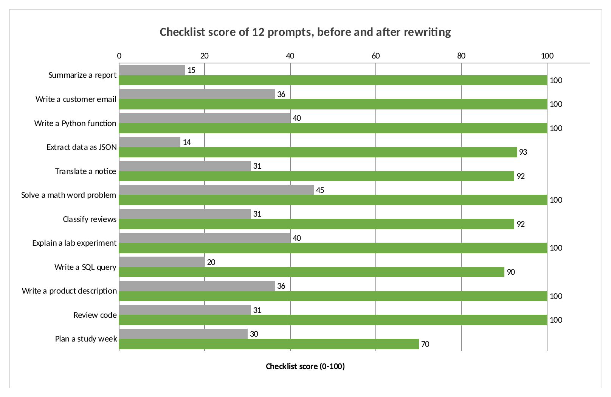
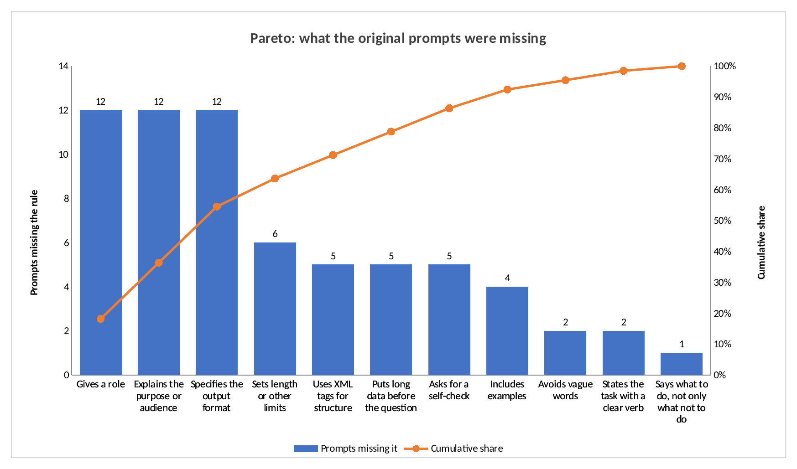
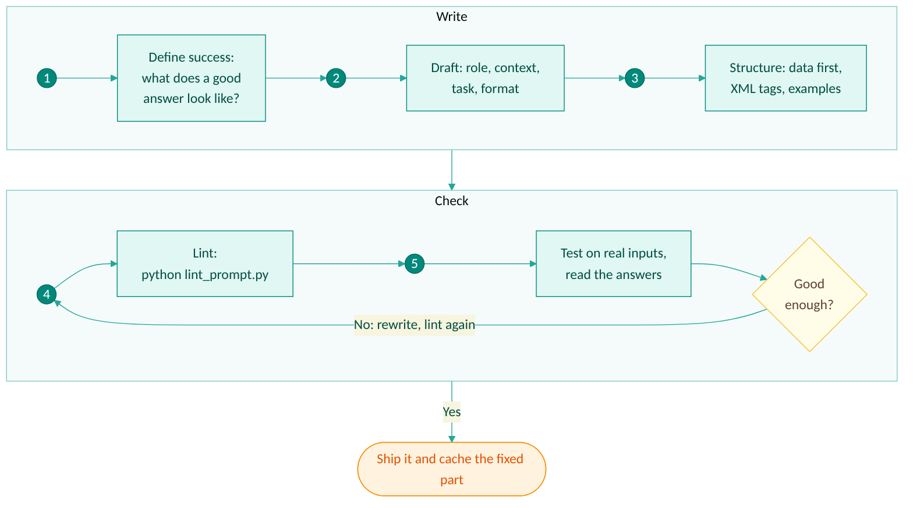
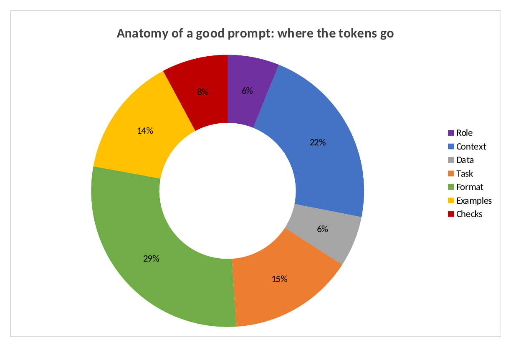
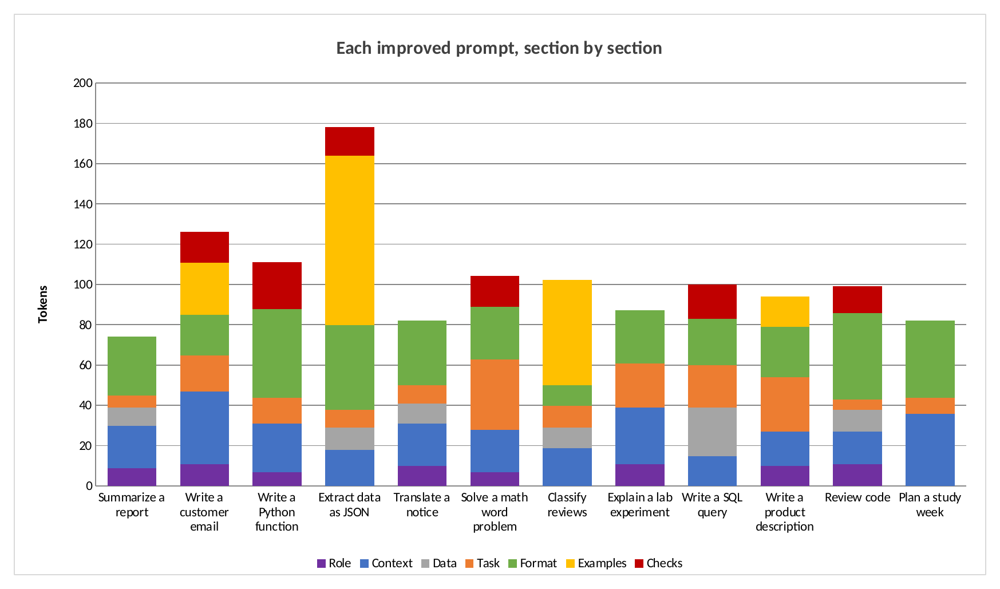
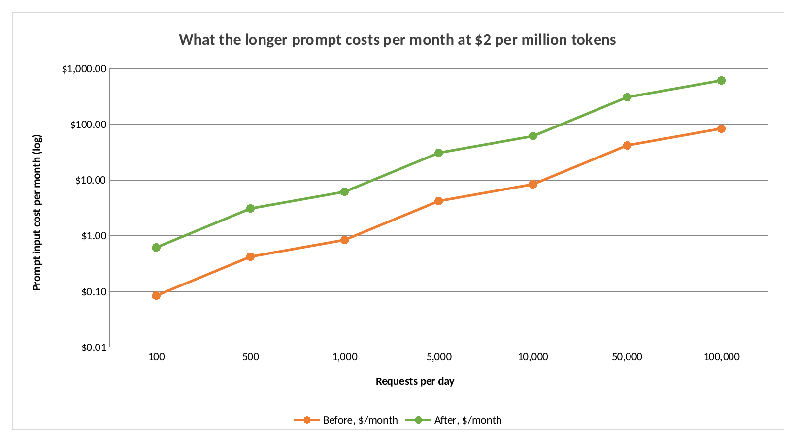
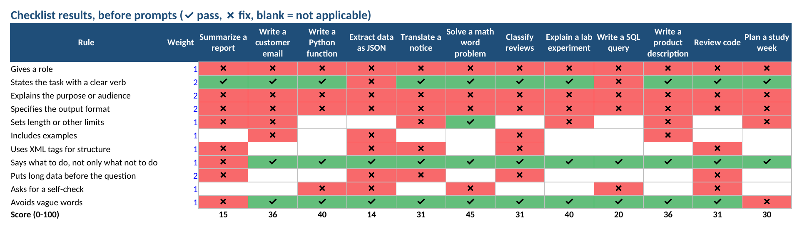
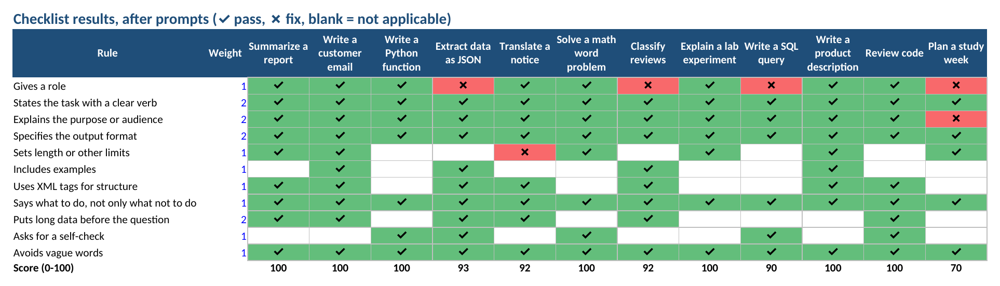
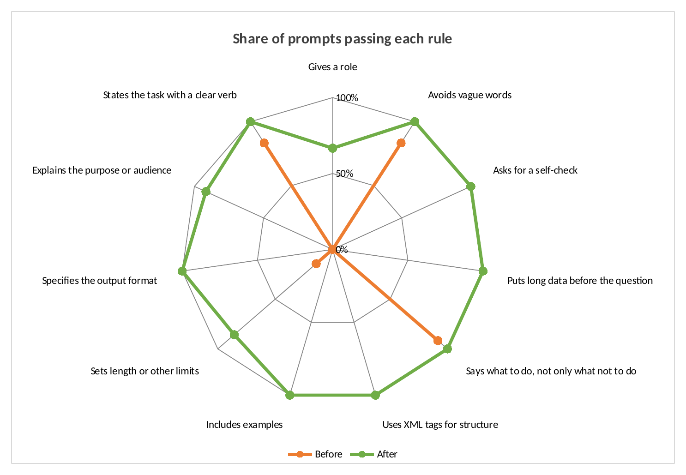
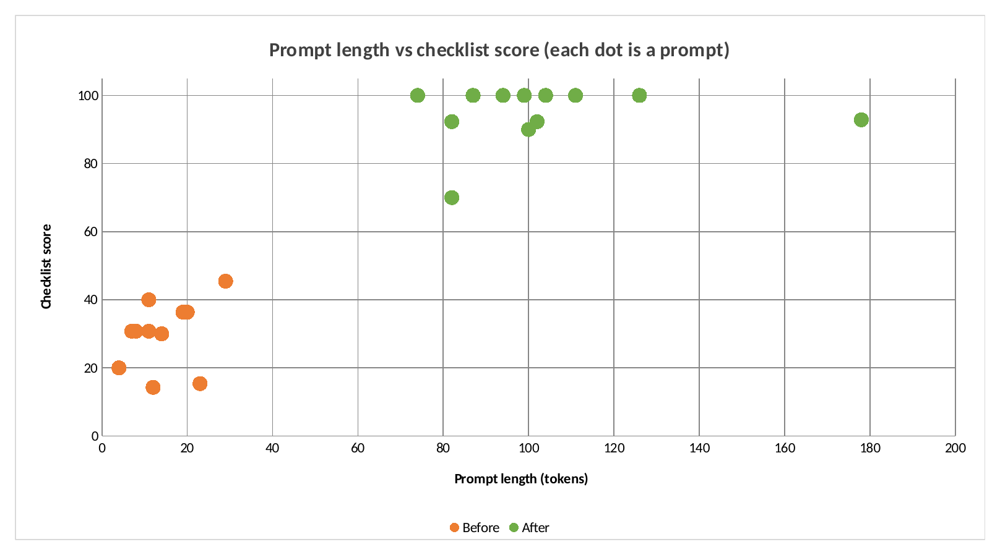

<div align="center">

# Prompt Engineering Lab

### How to write strong prompts: an 11-rule checklist built on Anthropic's guidance, a prompt linter, 12 before-and-after rewrites and ready templates


</div>

> Every chart is a **native Excel chart** from [`excel/prompt_engineering_lab.xlsx`](excel/prompt_engineering_lab.xlsx). Change a rule's weight in the workbook and every score updates.

## Contents

- [Why prompts matter](#why-prompts-matter)
- [Key results](#key-results)
- [The 11 rules](#the-11-rules)
- [How to write a prompt, step by step](#how-to-write-a-prompt-step-by-step)
- [Before and after: three full examples](#before-and-after-three-full-examples)
- [Anatomy of a good prompt](#anatomy-of-a-good-prompt)
- [Does a better prompt cost more?](#does-a-better-prompt-cost-more)
- [The scoring math](#the-scoring-math)
- [Result gallery](#result-gallery)
- [Templates](#templates)
- [Common mistakes](#common-mistakes)
- [Run it](#run-it)
- [Project layout](#project-layout)
- [FAQ](#faq)
- [Limits](#limits)
- [Sources](#sources)
- [ملخص بالعربي](#ملخص-بالعربي)

## Why prompts matter

A language model only knows what you put in the prompt. It does not know your audience, your standards, the format your code expects, or what "good" means for your task. Anthropic's guide puts it this way: think of the model as a brilliant but new employee who lacks context on your norms and workflows.

Most weak prompts fail the same way: they say *what* to do, but not *for whom*, *why*, *in what form* or *how long*. This lab turns Anthropic's published prompting advice into 11 checkable rules, scores 12 everyday prompts against them, rewrites each one, and shows exactly what changed.

## Key results



| | Original prompts | Rewritten prompts |
|---|---:|---:|
| Average checklist score | 31 / 100 | **95 / 100** |
| Average length | 14 tokens | 103 tokens |
| Prompts that set a role | 0 of 12 | 8 of 12 |
| Prompts that explain the purpose | 0 of 12 | 11 of 12 |
| Prompts that specify the output format | 0 of 12 | 12 of 12 |

What this shows:

- **The same three rules were missing from all 12 original prompts:** a role, the purpose or audience, and the output format.
- **The fixes are short.** On average a rewrite adds 89 tokens, about three sentences.
- **Extra cost is small.** At $2 per million input tokens and 1,000 requests a day, the longer prompts add about **$5.35 a month**.
- **Context and format take half of a good prompt.** In the rewrites, 29% of tokens describe the output format and 22% give context, while the task itself is 15%.



## The 11 rules

Each rule comes from Anthropic's [prompting best practices](https://platform.claude.com/docs/en/build-with-claude/prompt-engineering/claude-prompting-best-practices). The weight is how much it counts in the score.

| # | Rule | Weight | When it applies | Source section |
|---:|---|---:|---|---|
| 1 | Gives a role | 1 | Always | Give Claude a role |
| 2 | States the task with a clear verb | 2 | Always | Be clear and direct |
| 3 | Explains the purpose or audience | 2 | Always | Add context to improve performance |
| 4 | Specifies the output format | 2 | Always | Control the format of responses |
| 5 | Sets length or other limits | 1 | Writing, math, general tasks | Be clear and direct |
| 6 | Includes examples | 1 | Classification, extraction, style | Use examples effectively |
| 7 | Uses XML tags for structure | 1 | Prompts with data, examples or more than 600 characters | Structure prompts with XML tags |
| 8 | Says what to do, not only what not to do | 1 | Always | Tell Claude what to do instead of what not to do |
| 9 | Puts long data before the question | 2 | Prompts with a document or data block | Long context prompting |
| 10 | Asks for a self-check | 1 | Math, code, extraction | Leverage thinking |
| 11 | Avoids vague words | 1 | Always | Be clear and direct |

**Why each rule matters:**

1. **Role.** Anthropic's guide says that setting a role focuses behavior and tone, and that even a single sentence makes a difference.
2. **Clear task.** A verb such as *summarize*, *extract* or *classify* removes guessing about what the job is.
3. **Purpose.** The guide shows that explaining *why* helps the model generalize. Its example: instead of "never use ellipses", say the text will be read aloud by a text-to-speech engine that cannot pronounce them.
4. **Format.** If code will parse the answer, say exactly which keys and types. If a person will read it on a phone, say so.
5. **Limits.** "At most 5 bullets" is a requirement the model can meet. "Not too long" is not.
6. **Examples.** The guide says a few well-chosen examples improve accuracy and consistency, and recommends 3 to 5, wrapped in `<example>` tags.
7. **XML tags.** Tags such as `<document>` and `<instructions>` keep data, examples and instructions from blending together.
8. **Positive instructions.** "Write in flowing paragraphs" works better than "don't use bullet points", according to the guide.
9. **Data first.** The guide reports that putting the question at the end, after long documents, improved response quality by up to 30% in its tests.
10. **Self-check.** Asking the model to verify its answer against your criteria before finishing catches mistakes in math, code and data.
11. **Specific words.** Words such as *good*, *nice*, *some* or *properly* mean different things to different readers.

## How to write a prompt, step by step

<p align="center"></p>

1. **Define success first.** Write down what a perfect answer looks like and how you will check it. Anthropic's guide recommends having success criteria and a way to test them before tuning a prompt.
2. **Draft the four core parts:** role, context (who it is for and why), task (one clear verb) and format (exact shape and length).
3. **Structure it.** Put long data at the top inside tags, then instructions, then the question. Add examples for classification, extraction or a particular style.
4. **Lint it** with `python lint_prompt.py my_prompt.txt` to catch missing parts.
5. **Test it on real inputs** and read the answers. The checklist cannot tell you if the answers are right; only testing can.
6. **Ship it,** and keep the fixed part at the start so prompt caching can reuse it.

## Before and after: three full examples

**1. Extract data as JSON: score 14 → 93**

Before:
```text
Get the info from this invoice. {{INVOICE}}
```

After:
```text
<invoice>
{{INVOICE}}
</invoice>

The JSON goes straight into our accounting system, so the keys and types must match exactly.

Extract the invoice fields from the text above.

Return only a JSON object with these keys: invoice_number (string), date (YYYY-MM-DD),
supplier (string), total (number), currency (3-letter code). Use null when a field is missing.

<examples>
<example>Input: 'Inv #A-17, 3 Mar 2026, Nour Ltd, total IQD 250,000'
Output: {"invoice_number": "A-17", "date": "2026-03-03", "supplier": "Nour Ltd", "total": 250000, "currency": "IQD"}</example>
</examples>

Before answering, check that the total matches the number in the text.
```

What changed: the data moved to the top in tags, the purpose explains why exact types matter, the format names every key and type, one example shows the target, and a self-check guards the most important field.

**2. Solve a math word problem: score 45 → 100**

Before:
```text
A tank fills in 6 hours and drains in 9. How long to fill? Just give me the answer, don't explain too much.
```

After:
```text
You are a careful math tutor.

The answer will be shown to a student checking their homework, so the steps must be easy to follow.

Solve: a tank fills in 6 hours with the inlet open and drains in 9 hours with the outlet open.
How long does it take to fill with both open?

Show the work in at most 4 numbered steps, then give the final answer inside <answer></answer> tags in hours.

Before you finish, verify the answer by plugging it back into the rates.
```

What changed: the ambiguous "drains in 9" now states what is open, the steps are limited to 4 instead of "don't explain too much", the answer has a fixed place, and the model is asked to verify.

**3. Explain a lab experiment: score 40 → 100**

Before:
```text
Explain the diode experiment to students in a good way.
```

After:
```text
You are a lab instructor for an Electronics Fundamentals course.

The students are in their second year and will do the experiment next week,
so they need to know what to expect on the oscilloscope.

Explain the half-wave rectifier experiment: what the diode does, what the output waveform looks like, and why.

Use 3 short sections with headings: Goal, What you will see, Why it happens. Under 250 words in total.
```

What changed: "the diode experiment" became a named experiment, "students" became second-year students preparing for a lab, and "in a good way" became three named sections under 250 words.

All 12 pairs are in [`data/prompt_pairs.json`](data/prompt_pairs.json).

## Anatomy of a good prompt

| Where the tokens go | Each rewrite, section by section |
|---|---|
|  |  |

| Section | Share of tokens | Purpose |
|---|---:|---|
| Format | 29% | The exact shape, length and order of the answer |
| Context | 22% | Who it is for and why |
| Task | 15% | What to do, with a clear verb |
| Examples | 14% | Show the target instead of describing it |
| Checks | 8% | What to verify before finishing |
| Role | 6% | One sentence that sets expertise and tone |
| Data | 6% | Tags around the input (the input itself is a placeholder here) |

## Does a better prompt cost more?

Yes, a little. The rewrites are about 89 tokens longer. With input priced at $2 per million tokens (Claude Sonnet 5.5, November 2026):

$$\Delta C_{month} = R_{day} \times 30 \times \Delta T \times \frac{p}{10^6} = 1000 \times 30 \times 89 \times \frac{2}{10^6} \approx \$5.35$$



Two notes:

- A vague prompt that needs a second try costs a whole extra request, including its output, which usually costs much more than 89 input tokens.
- When the fixed part of a prompt is long enough to cache (at least 512 tokens on the newest Claude models), prompt caching makes repeated use of it much cheaper.

## The scoring math

For a prompt with rule results $r_i \in \{1, 0, \varnothing\}$ (pass, fail, not applicable) and weights $w_i$:

$$\text{Score} = 100 \times \frac{\sum_{i:\,r_i \neq \varnothing} w_i\, r_i}{\sum_{i:\,r_i \neq \varnothing} w_i}$$

Rules that do not apply to a task, such as examples for a math problem, are left out instead of counted as failures. In Excel this is one `SUMPRODUCT` formula per prompt.

## Result gallery

### Rule by rule

| Original prompts | Rewritten prompts |
|---|---|
|  |  |



### Length and score



## Templates

Ready prompts in [`templates/`](templates), each scoring 92 to 100 on the checklist. Replace the `{{PLACEHOLDERS}}`:

| Template | Use it for |
|---|---|
| `summarize.txt` | Reports, articles, meeting notes |
| `extract_json.txt` | Turning text into structured data |
| `classify.txt` | Labels such as sentiment, topic or priority |
| `code.txt` | Functions with tests |
| `writing.txt` | Emails, posts, product text |
| `long_documents.txt` | Questions over several documents, with quotes first |

## Common mistakes

| Mistake | Better |
|---|---|
| "Make it good" | Say what good means: audience, length, tone |
| "Don't make it too long" | "At most 5 bullets, each under 25 words" |
| "Don't use markdown" | "Write in plain paragraphs" |
| Question first, 20 pages of data after | Data first, question at the end |
| "Get the info" | Name every field and its type |
| One example copied many times | 3 to 5 different examples |
| No way to check the answer | "Before you finish, verify ..." |
| A timestamp at the top of the system prompt | Put changing details at the end, so caching still works |

## Run it

```bash
pip install -r requirements.txt

python lint_prompt.py templates/summarize.txt              # check one prompt
python lint_prompt.py my_prompt.txt --kind extract         # kinds: general, style, code, math, extract, classify, data

python run_analysis.py           # scores the 12 pairs -> results/analysis.json
python build_excel.py            # workbook with formulas and charts
python render_excel_charts.py    # chart images, needs LibreOffice
pytest tests
```

Example output for the original customer email prompt, *"Write an email to a customer about the delay. Be nice and professional. Don't blame us."*:

```text
Score: 36/100

  [FIX ] Gives a role
  [PASS] States the task with a clear verb
  [FIX ] Explains the purpose or audience
  [FIX ] Specifies the output format
  [FIX ] Sets length or other limits
  [FIX ] Includes examples
  [n/a ] Uses XML tags for structure
  [PASS] Says what to do, not only what not to do
  [n/a ] Puts long data before the question
  [n/a ] Asks for a self-check
  [PASS] Avoids vague words

Suggestions:
  - Start with one sentence that sets a role, for example 'You are a support agent for ...'.
  - Say who the answer is for and why, so the model can make sensible choices.
  - Describe the exact output format: a JSON object with named keys, a table, numbered steps ...
  - Set limits: 'at most 5 bullets', '120 words', 'one paragraph'.
  - Add 3 to 5 short examples inside <examples> tags.
```

## Project layout

```text
promptlab/lint.py           The 11 rules, scoring and advice
promptlab/tokens.py         Token counts (open Llama 4 tokenizer as a stand-in)
lint_prompt.py              Command-line checker
run_analysis.py             Scores the 12 pairs
build_excel.py              Workbook with SUMPRODUCT scores and charts
render_excel_charts.py      Exports chart images
data/prompt_pairs.json      12 original prompts and their rewrites
templates/                  6 ready prompts
xlkit/charts.py             Excel chart helpers and renderer
excel/prompt_engineering_lab.xlsx
```

## FAQ

**Does a 100 score mean the prompt works?**
No. The score shows that the prompt contains the parts the guidance recommends. Only testing on real inputs shows whether the answers are right.

**Is a longer prompt always better?**
No. Every rewrite here is under 200 tokens. Add what the model needs, then stop.

**Should every prompt have XML tags and examples?**
No. The checklist only asks for tags when a prompt mixes data, examples or long text, and only asks for examples where a pattern helps, such as labels or a style.

**Does this work for models other than Claude?**
The rules are general good practice, but they come from Anthropic's guide for Claude. Other providers publish their own advice.

**Can I write prompts in Arabic?**
Yes. The rules are the same. The linter's keyword checks are in English, so it scores Arabic prompts poorly; translate the checklist in your head or extend the patterns in `promptlab/lint.py`.

## Limits

- **The checklist uses keyword rules,** so it can be fooled. For example, "6 hours" inside a math problem counts as a length limit.
- **The rewritten prompts were written with the checklist in mind,** so their high scores show the checklist working, not proof that the answers improve.
- **Answer quality was not measured.** No model was called while building this project.
- Token counts use the open Llama 4 tokenizer as a stand-in. Claude's counts differ.
- The 12 prompts are examples written for this project, not a sample of real users.

## Sources

- Anthropic, [Prompt engineering overview](https://platform.claude.com/docs/en/build-with-claude/prompt-engineering/overview)
- Anthropic, [Prompting best practices](https://platform.claude.com/docs/en/build-with-claude/prompt-engineering/claude-prompting-best-practices)
- Anthropic, [Pricing](https://platform.claude.com/docs/en/about-claude/pricing), for the $2 per million input token example

## Author

**Jaafar Salim**, University of Technology, Iraq

## ملخص بالعربي

<div dir="rtl">

هذا المشروع يعلّمك شلون تكتب برومت قوي، بقائمة من 11 قاعدة مأخوذة من دليل Anthropic الرسمي، وأداة تفحص البرومت وتعطيه درجة، و12 مثال قبل وبعد التحسين، و6 قوالب جاهزة.

- **أكثر غلط:** كل البرومتات الأصلية الـ 12 ما بيها دور، ولا سبب أو جمهور، ولا شكل مطلوب للجواب.
- **بعد التحسين:** الدرجة ارتفعت من 31 إلى 95 بالمعدل.
- **الكلفة:** البرومت المحسّن أطول بحوالي 89 توكن، يعني تقريباً 5 دولار زيادة بالشهر لألف طلب باليوم.
- **أهم نصيحة:** حط البيانات الطويلة أول، والسؤال بالآخر، وكول للنموذج شكل الجواب بالضبط وطوله.

الدرجة تبين شنو موجود بالبرومت، مو جودة الجواب، فلازم تجرب البرومت على أمثلة حقيقية.

</div>
